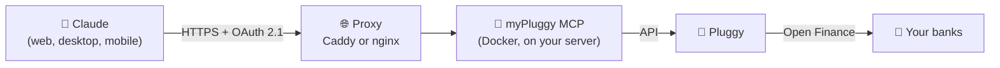

<div align="center">

# 💸 myPluggy MCP

**Talk to Claude about your money.**
Connect your Brazilian bank accounts to Claude through Open Finance, securely and read-only.

[Português](README.md) · **English**

[](https://modelcontextprotocol.io)
[](https://claude.ai)
[](https://pluggy.ai)
[](https://www.typescriptlang.org)
[](https://nodejs.org)
[](https://www.docker.com)
[](LICENSE)

</div>

---

## 📌 Contents

- [What it is](#-what-it-is)
- [What you can ask](#-what-you-can-ask)
- [How it works](#️-how-it-works)
- [Available tools](#-available-tools)
- [What you'll need](#-what-youll-need)
- [Step-by-step setup](#-step-by-step-setup)
- [Security and privacy](#️-security-and-privacy)
- [FAQ](#-faq)
- [Limitations](#️-limitations)
- [Development](#-development)

---

## 🤔 What it is

**myPluggy MCP** is a server you host yourself that connects [Claude](https://claude.ai) to your bank accounts through [Pluggy](https://pluggy.ai), an **Open Finance Brasil** platform. Once it's set up, you ask about your finances in plain language and Claude pulls the data straight from your banks.

> **MCP** (Model Context Protocol) is the open standard that lets Claude use external tools. This project is one of those tools: you add it once as a **custom connector** and it's available on claude.ai, the desktop app, mobile and Claude Code.

**Highlights:**

- 🔒 **Read-only**: no tool makes payments, transfers or changes anything.
- 🏦 **Many banks at once**: Nubank, Inter, Mercado Pago, Itaú and others, per [Pluggy's coverage](https://pluggy.ai).
- 🔑 **Passkey login**: Face ID, Touch ID, Windows Hello or a security key. No password to leak.
- 🏠 **Your data, your server**: everyone runs their own instance. Nothing goes anywhere other than Pluggy and Claude.
- 🐳 **Runs on Docker**: one command, with automatic HTTPS.

> [!IMPORTANT]
> Personal, **unofficial** project, not affiliated with Pluggy or Anthropic. Tool names and responses are in Portuguese because the data (Brazilian banks and categories) is; Claude handles that fine in any language.

---

## 💬 What you can ask

> 💭 *"How much did I spend on restaurants in September?"*
>
> 💭 *"What's my total balance across all banks?"*
>
> 💭 *"When is my credit card bill due, and what's the minimum payment?"*
>
> 💭 *"List this month's purchases above R$ 500."*
>
> 💭 *"Compare my spending by category between August and September."*
>
> 💭 *"How much do I have invested, and how much has it earned?"*

Claude picks the right tool on its own, combines the data and answers with analysis, tables or charts.

---

## ⚙️ How it works



1. You connect your banks in **Meu Pluggy**, Pluggy's free app for personal use.
2. **myPluggy MCP** runs on your server and reads that data through Pluggy's API.
3. **Claude** connects to your server. The first time, you approve with your passkey.

---

## 🧰 Available tools

| | Tool | What it does | Parameters |
|:-:|---|---|---|
| 🏦 | `listar_contas` | Accounts and cards with balance, limit and bill dates | — |
| 📄 | `listar_transacoes` | Transactions in a date range, newest first (negative = outflow) | `de`, `ate` (YYYY-MM-DD), `conta_id?`, `limite?` |
| 📊 | `resumo_por_categoria` | Spending grouped by category, with percentages | `de`, `ate`, `conta_id?` |
| 💳 | `listar_faturas_cartao` | Open bill (due date and minimum) and recent closed bills | `conta_id?`, `quantidade?` |
| 📈 | `listar_investimentos` | Investment positions, when the bank provides them | — |

> [!TIP]
> The category summary skips transfers between your own accounts, bill payments and investment moves, so the same money isn't counted twice.

---

## 📋 What you'll need

| Item | Why | Cost |
|---|---|---|
| 🔌 A [Pluggy](https://dashboard.pluggy.ai) + [Meu Pluggy](https://meu.pluggy.ai) account | Access bank data through Open Finance | Free for personal use |
| 🖥️ A Linux server (VPS) with Docker | Keep the MCP online 24/7 | Free options exist, like Oracle Cloud Always Free |
| 🌐 A domain or subdomain | HTTPS address for Claude to reach | Optional: [sslip.io](https://sslip.io) is free |
| 💬 A [Claude](https://claude.ai) account | Use the connector | Depends on your plan |

> [!NOTE]
> **No domain?** sslip.io turns your server's IP into an address. If the IP is `203.0.113.10`, use `mcp.203-0-113-10.sslip.io`, with no signup or setup.

**Expected skills:** SSH into a server, edit a text file and run terminal commands. The steps below cover the rest.

---

## 🚀 Step-by-step setup

### 1️⃣ Connect your banks in Pluggy

1. At [meu.pluggy.ai](https://meu.pluggy.ai), create an account and connect your banks. Each bank is authorized in its own app.
2. Sign in to the [Pluggy Dashboard](https://dashboard.pluggy.ai) **with the same account**, open *Applications → your application* and copy the **Client ID** and **Client Secret**.
3. In the *Demo* tab, click **Connect Account** and pick the **MeuPluggy** connector in the widget (not your bank, not the Sandbox).
4. Each connected bank becomes an **item**. Copy the IDs from *Demo → Connected Items*.

> [!NOTE]
> Pluggy's API doesn't list items for personal applications, so the IDs go in the config. Official guide: [Personal use with Meu Pluggy](https://docs.pluggy.ai/en/docs/guides/meu-pluggy-personal-use).

### 2️⃣ Download and configure on the server

```bash
git clone https://github.com/Gabrielhsb/mypluggy-MCP.git
cd mypluggy-MCP
cp .env.example .env
openssl rand -base64 32   # generates a random value for SETUP_TOKEN
nano .env                 # fill in the variables below
```

| Variable | What to put |
|---|---|
| `PLUGGY_CLIENT_ID` / `PLUGGY_CLIENT_SECRET` | Credentials from the Pluggy Dashboard |
| `PLUGGY_ITEM_IDS` | Item IDs, comma-separated |
| `PUBLIC_URL` | Public address, e.g. `https://mcp.yourdomain.com` |
| `SETUP_TOKEN` | The value generated above; used only to register the first passkey |
| `MCP_DOMAIN` | Same domain as `PUBLIC_URL`, without `https://` (option A only) |

**Test the Pluggy connection.** The diagnostic prints counts only, never values:

```bash
docker compose run --rm mcp node dist/doctor.js
```

If you see `Tudo certo: credenciais e itens acessíveis.` ("all good"), move on.

### 3️⃣ Go live

<details open>
<summary><b>🅰️ Fresh server (recommended): Caddy with automatic HTTPS</b></summary>

```bash
docker compose --profile caddy up -d --build
```

Caddy issues and renews the HTTPS certificate on its own.

</details>

<details>
<summary><b>🅱️ Server already running nginx on ports 80/443</b></summary>

```bash
docker compose up -d --build   # MCP listens on 127.0.0.1:3000 only
```

1. Copy [`deploy/nginx.conf.example`](deploy/nginx.conf.example) to `/etc/nginx/sites-available/`, change the domain and enable the site.
2. Get a certificate with `sudo certbot --nginx -d mcp.yourdomain.com`.
3. If port 3000 is taken, set `MCP_HOST_PORT` in `.env` and update `proxy_pass`.

</details>

**🧱 Firewall:** keep only ports 22, 80 and 443 open.

```bash
sudo ufw allow 22,80,443/tcp && sudo ufw enable
```

> [!WARNING]
> On clouds like Oracle, AWS and GCP, open the same ports in the instance's network rules too (*security list* or *security group*). HTTPS won't work otherwise.

**✅ Check:** open `https://mcp.yourdomain.com/health` in your browser. You should see `{"ok":true}`.

### 4️⃣ Connect to Claude

1. On [claude.ai](https://claude.ai), go to **Settings → Connectors → Add custom connector**.
2. Enter `https://mcp.yourdomain.com/mcp` as the URL.
3. Click **Connect**. Your server's authorization page opens:
   - **First time:** paste the `SETUP_TOKEN` and register your passkey.
   - **After that:** just confirm with the passkey.
4. 🎉 Done! Ask something about your finances in a new conversation.

> [!TIP]
> The connector is saved to your Claude **account**. It shows up automatically in the browser, desktop app, mobile and Claude Code, on any computer. No need to set it up again.

---

## 🛡️ Security and privacy

| | Protection |
|:-:|---|
| 🔒 | **Read-only**: no tool writes, pays or moves money. |
| 🔑 | **OAuth 2.1 + PKCE + passkey**: only someone with your passkey can authorize access. |
| 🎟️ | **SETUP_TOKEN** guards passkey registration; 5 failures in 15 minutes block further attempts. |
| ⏱️ | **Short-lived tokens**: 1-hour access, 30-day refresh. |
| 🚦 | **Rate limits**: 60 req/min on `/mcp` and 30 req/min on login routes. |
| 📝 | **No sensitive data in logs**: only path, status, duration and tool name. |
| 🗝️ | **Credentials only in `.env`**, kept out of Git and the Docker image. |
| 🐳 | **Unprivileged container**, exposed only to the local proxy (`127.0.0.1`). |
| 🧱 | **Hardened login page** with a strict CSP and iframe blocking. |

**Revoke all access:** delete `tokenSecret` from `/data/state.json` (volume `mcp-data`) and restart the container. Claude will ask for your passkey again.

Found a vulnerability? See [SECURITY.md](SECURITY.md).

---

## ❓ FAQ

<details>
<summary><b>Do I have to pay for anything?</b></summary>

Meu Pluggy is free for personal use (non-commercial, with a connection limit). The server can be free (Oracle Cloud Always Free, for example), and so can the domain with sslip.io. Claude connectors follow whatever your plan allows.
</details>

<details>
<summary><b>Can Claude make a Pix transfer or pay a bill?</b></summary>

No. The server only has read tools, and Meu Pluggy only grants read access.
</details>

<details>
<summary><b>Is my data stored on the server?</b></summary>

No. The server queries Pluggy on every question and doesn't store transactions or balances. Only what login needs is kept on disk: the passkey (public key) and the OAuth client registration.
</details>

<details>
<summary><b>Is the data real-time?</b></summary>

Almost. Meu Pluggy refreshes banks about once a day, so a purchase made today may only show up tomorrow.
</details>

<details>
<summary><b>Can I use it on my work computer or phone?</b></summary>

Yes. The connector lives in your Claude account and works on any device signed in to it. You're asked for the passkey again only when access expires (30 days without use).
</details>

<details>
<summary><b>I lost my phone/passkey. Now what?</b></summary>

Over SSH, delete `/data/state.json` from the volume (this removes passkeys and access) and restart the container. On the next Connect, register a new passkey with the `SETUP_TOKEN`.
</details>

<details>
<summary><b>How do I update to a new version?</b></summary>

```bash
cd mypluggy-MCP && git pull && docker compose up -d --build
```
</details>

---

## ⚠️ Limitations

- 💳 Pluggy doesn't provide the **open bill amount**, only its due date and minimum payment. Closed bills come complete. For a partial total, ask Claude to sum the card's transactions since the last closing date.
- 🕐 Meu Pluggy data is refreshed about once a day.
- 👤 **One owner per instance**: the passkey grants access to every configured bank. For another person, run another instance.

---

## 🧑‍💻 Development

Requires **Node.js 20.6+**.

```bash
npm install
cp .env.example .env   # use PUBLIC_URL=http://localhost:3000 (passkeys work on localhost)
npm run doctor         # check Pluggy credentials and items
npm run dev            # server with auto-reload
npm test               # tests
npm run lint           # ESLint + type check
npm run build          # compile to dist/
```

To test without Claude, point the [MCP Inspector](https://github.com/modelcontextprotocol/inspector) at `http://localhost:3000/mcp`.

<details>
<summary><b>📁 Project structure</b></summary>

```
src/
├── index.ts         # startup
├── app.ts           # HTTP routes (OAuth, /mcp, /health)
├── tools.ts         # the 5 MCP tools
├── pluggy.ts        # Pluggy API queries
├── finance.ts       # formatting and math (dates, categories, bills)
├── doctor.ts        # connection diagnostic
└── auth/            # OAuth 2.1, passkey, tokens and login page
deploy/              # Caddyfile and nginx example
```
</details>

Contributions are welcome: open an *issue* or a *pull request*.

---

<div align="center">

[MIT](LICENSE) license · Made with ☕ for anyone who wants to know where their money goes.

</div>
