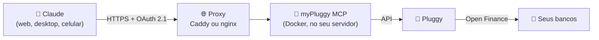

<div align="center">

# 💸 myPluggy MCP

**Converse com o Claude sobre o seu dinheiro.**
Conecte suas contas bancárias brasileiras ao Claude via Open Finance, com segurança e somente leitura.

**Português** · [English](README.en.md)

[](https://modelcontextprotocol.io)
[](https://claude.ai)
[](https://pluggy.ai)
[](https://www.typescriptlang.org)
[](https://nodejs.org)
[](https://www.docker.com)
[](LICENSE)

</div>

---

## 📌 Sumário

- [O que é](#-o-que-é)
- [O que dá pra perguntar](#-o-que-dá-pra-perguntar)
- [Como funciona](#️-como-funciona)
- [Ferramentas disponíveis](#-ferramentas-disponíveis)
- [O que você vai precisar](#-o-que-você-vai-precisar)
- [Instalação passo a passo](#-instalação-passo-a-passo)
- [Segurança e privacidade](#-segurança-e-privacidade)
- [Perguntas frequentes](#-perguntas-frequentes)
- [Limitações](#️-limitações)
- [Desenvolvimento](#-desenvolvimento)

---

## 🤔 O que é

O **myPluggy MCP** é um servidor que você hospeda e que liga o [Claude](https://claude.ai) às suas contas bancárias através do [Pluggy](https://pluggy.ai), uma plataforma de **Open Finance Brasil**. Depois de instalado, você pergunta sobre suas finanças em linguagem natural e o Claude busca os dados direto dos seus bancos.

> **MCP** (Model Context Protocol) é o padrão aberto que permite ao Claude usar ferramentas externas. Este projeto é uma dessas ferramentas: você adiciona uma vez como **conector personalizado** e ela fica disponível no claude.ai, no app desktop, no celular e no Claude Code.

**Destaques:**

- 🔒 **Somente leitura**: nenhuma ferramenta faz pagamento, transferência ou qualquer alteração.
- 🏦 **Vários bancos de uma vez**: Nubank, Inter, Mercado Pago, Itaú e outros, conforme a [cobertura do Pluggy](https://pluggy.ai).
- 🔑 **Login por passkey**: Face ID, Touch ID, Windows Hello ou chave física. Não existe senha para vazar.
- 🏠 **Seus dados, seu servidor**: cada pessoa roda a própria instância. Nada passa por terceiros além do Pluggy e do Claude.
- 🐳 **Sobe com Docker**: um comando, com HTTPS automático.

> [!IMPORTANT]
> Projeto pessoal e **não oficial**, sem vínculo com a Pluggy ou com a Anthropic.

---

## 💬 O que dá pra perguntar

> 💭 *"Quanto gastei com restaurante em setembro?"*
>
> 💭 *"Qual é o meu saldo somando todos os bancos?"*
>
> 💭 *"Quando vence a fatura do cartão e qual o valor mínimo?"*
>
> 💭 *"Liste as compras acima de R$ 500 deste mês."*
>
> 💭 *"Compare meus gastos por categoria entre agosto e setembro."*
>
> 💭 *"Quanto tenho investido e quanto rendeu?"*

O Claude escolhe sozinho qual ferramenta usar, cruza os dados e responde com análises, tabelas ou gráficos.

---

## ⚙️ Como funciona



1. Você conecta seus bancos no **Meu Pluggy**, o app gratuito do Pluggy para uso pessoal.
2. O **myPluggy MCP** roda no seu servidor e consulta esses dados pela API do Pluggy.
3. O **Claude** se conecta ao seu servidor. No primeiro acesso, você aprova com sua passkey.

---

## 🧰 Ferramentas disponíveis

| | Ferramenta | O que faz | Parâmetros |
|:-:|---|---|---|
| 🏦 | `listar_contas` | Contas e cartões com saldo, limite e datas da fatura | — |
| 📄 | `listar_transacoes` | Transações do período, da mais recente à mais antiga (negativo = saída) | `de`, `ate` (AAAA-MM-DD), `conta_id?`, `limite?` |
| 📊 | `resumo_por_categoria` | Gastos agrupados por categoria, com percentual | `de`, `ate`, `conta_id?` |
| 💳 | `listar_faturas_cartao` | Fatura aberta (vencimento e mínimo) e últimas faturas fechadas | `conta_id?`, `quantidade?` |
| 📈 | `listar_investimentos` | Posição dos investimentos, quando o banco disponibiliza | — |

> [!TIP]
> O resumo por categoria ignora transferências entre suas próprias contas, pagamento de fatura e aplicações/resgates. Assim o mesmo dinheiro não é contado duas vezes.

---

## 📋 O que você vai precisar

| Item | Para quê | Custo |
|---|---|---|
| 🔌 Conta no [Pluggy](https://dashboard.pluggy.ai) + [Meu Pluggy](https://meu.pluggy.ai) | Acessar os dados dos bancos via Open Finance | Gratuito para uso pessoal |
| 🖥️ Um servidor Linux (VPS) com Docker | Deixar o MCP no ar 24 horas | Há opções gratuitas, como o Oracle Cloud Always Free |
| 🌐 Um domínio ou subdomínio | Endereço com HTTPS para o Claude acessar | Opcional: o [sslip.io](https://sslip.io) é gratuito |
| 💬 Conta no [Claude](https://claude.ai) | Usar o conector | Conforme seu plano |

> [!NOTE]
> **Sem domínio?** O sslip.io transforma o IP do servidor num endereço. Se o IP for `203.0.113.10`, use `mcp.203-0-113-10.sslip.io`, sem cadastro nem configuração.

**Conhecimento esperado:** acessar um servidor por SSH, editar um arquivo de texto e rodar comandos no terminal. O passo a passo abaixo cobre o resto.

---

## 🚀 Instalação passo a passo

### 1️⃣ Conectar seus bancos no Pluggy

1. Em [meu.pluggy.ai](https://meu.pluggy.ai), crie sua conta e conecte seus bancos. A autorização é feita no app de cada banco.
2. Entre no [Dashboard do Pluggy](https://dashboard.pluggy.ai) **com a mesma conta**, abra *Applications → sua aplicação* e copie o **Client ID** e o **Client Secret**.
3. Na aba *Demo*, clique em **Connect Account** e, no widget, escolha o conector **MeuPluggy** (não o banco nem o Sandbox).
4. Cada banco conectado vira um **item**. Copie os IDs em *Demo → Connected Items*.

> [!NOTE]
> A API do Pluggy não lista os itens para aplicações pessoais, por isso os IDs vão na configuração. Guia oficial: [Personal use with Meu Pluggy](https://docs.pluggy.ai/en/docs/guides/meu-pluggy-personal-use).

### 2️⃣ Baixar e configurar no servidor

```bash
git clone https://github.com/Gabrielhsb/mypluggy-MCP.git
cd mypluggy-MCP
cp .env.example .env
openssl rand -base64 32   # gera um código aleatório para o SETUP_TOKEN
nano .env                 # preencha as variáveis abaixo
```

| Variável | O que colocar |
|---|---|
| `PLUGGY_CLIENT_ID` / `PLUGGY_CLIENT_SECRET` | Credenciais copiadas do Dashboard do Pluggy |
| `PLUGGY_ITEM_IDS` | IDs dos itens, separados por vírgula |
| `PUBLIC_URL` | Endereço público, ex.: `https://mcp.seudominio.com` |
| `SETUP_TOKEN` | O código gerado acima; é usado só para cadastrar a primeira passkey |
| `MCP_DOMAIN` | Mesmo domínio do `PUBLIC_URL`, sem `https://` (só na opção A) |

**Teste a conexão com o Pluggy.** O diagnóstico mostra só contagens, nunca valores:

```bash
docker compose run --rm mcp node dist/doctor.js
```

Se aparecer `Tudo certo: credenciais e itens acessíveis.`, pode seguir.

### 3️⃣ Colocar no ar

<details open>
<summary><b>🅰️ Servidor novo (recomendado): Caddy com HTTPS automático</b></summary>

```bash
docker compose --profile caddy up -d --build
```

O Caddy emite e renova o certificado HTTPS sozinho.

</details>

<details>
<summary><b>🅱️ Servidor que já usa nginx nas portas 80/443</b></summary>

```bash
docker compose up -d --build   # o MCP fica só em 127.0.0.1:3000
```

1. Copie [`deploy/nginx.conf.example`](deploy/nginx.conf.example) para `/etc/nginx/sites-available/`, troque o domínio e ative o site.
2. Gere o certificado com `sudo certbot --nginx -d mcp.seudominio.com`.
3. Se a porta 3000 já estiver ocupada, defina `MCP_HOST_PORT` no `.env` e ajuste o `proxy_pass`.

</details>

**🧱 Firewall:** deixe abertas só as portas 22, 80 e 443.

```bash
sudo ufw allow 22,80,443/tcp && sudo ufw enable
```

> [!WARNING]
> Em nuvens como Oracle, AWS e GCP, libere as mesmas portas também na regra de rede da instância (*security list* ou *security group*). Sem isso o HTTPS não funciona.

**✅ Teste:** abra `https://mcp.seudominio.com/health` no navegador. Deve aparecer `{"ok":true}`.

### 4️⃣ Conectar no Claude

1. No [claude.ai](https://claude.ai), vá em **Settings → Connectors → Add custom connector**.
2. Em URL, informe `https://mcp.seudominio.com/mcp`.
3. Clique em **Connect**. Abre a página de autorização do seu servidor:
   - **Primeira vez:** cole o `SETUP_TOKEN` e registre sua passkey.
   - **Próximas vezes:** só confirme com a passkey.
4. 🎉 Pronto! Pergunte algo sobre suas finanças numa conversa nova.

> [!TIP]
> O conector fica salvo na sua **conta** do Claude. Ele aparece automaticamente no navegador, no app desktop, no celular e no Claude Code, em qualquer computador. Não precisa instalar de novo.

---

## 🛡️ Segurança e privacidade

| | Proteção |
|:-:|---|
| 🔒 | **Somente leitura**: nenhuma ferramenta escreve, paga ou movimenta dinheiro. |
| 🔑 | **OAuth 2.1 + PKCE + passkey**: só quem tem sua passkey autoriza o acesso. |
| 🎟️ | **SETUP_TOKEN** protege o cadastro da passkey; 5 erros em 15 minutos bloqueiam novas tentativas. |
| ⏱️ | **Tokens de curta duração**: acesso de 1 hora, renovação por 30 dias. |
| 🚦 | **Rate limit**: 60 req/min no `/mcp` e 30 req/min nas rotas de login. |
| 📝 | **Logs sem dados sensíveis**: registram só rota, status, duração e nome da ferramenta. |
| 🗝️ | **Credenciais só no `.env`**, fora do Git e da imagem Docker. |
| 🐳 | **Container sem privilégios**, exposto só para o proxy local (`127.0.0.1`). |
| 🧱 | **Página de login protegida** com CSP restritiva e bloqueio de iframe. |

**Revogar todos os acessos:** apague `tokenSecret` de `/data/state.json` (volume `mcp-data`) e reinicie o container. O Claude vai pedir a passkey de novo.

Encontrou uma vulnerabilidade? Veja [SECURITY.md](SECURITY.md).

---

## ❓ Perguntas frequentes

<details>
<summary><b>Preciso pagar alguma coisa?</b></summary>

O Meu Pluggy é gratuito para uso pessoal (não comercial, com limite de conexões). O servidor pode ser gratuito (Oracle Cloud Always Free, por exemplo), assim como o domínio, com o sslip.io. Para conectores no Claude, vale o que o seu plano permitir.
</details>

<details>
<summary><b>O Claude consegue fazer um Pix ou pagar uma conta?</b></summary>

Não. O servidor só tem ferramentas de leitura, e o Meu Pluggy só dá acesso a consulta.
</details>

<details>
<summary><b>Meus dados ficam guardados no servidor?</b></summary>

Não. O servidor consulta o Pluggy a cada pergunta e não salva transações nem saldos. Em disco fica só o necessário para o login: a passkey (chave pública) e o registro do cliente OAuth.
</details>

<details>
<summary><b>Os dados são em tempo real?</b></summary>

Quase. O Meu Pluggy atualiza os bancos cerca de uma vez por dia, então uma compra de hoje pode aparecer só amanhã.
</details>

<details>
<summary><b>Posso usar no computador do trabalho ou no celular?</b></summary>

Sim. O conector fica na sua conta do Claude e funciona em qualquer dispositivo logado nela. A passkey é pedida de novo só quando o acesso expira (30 dias sem uso).
</details>

<details>
<summary><b>Perdi meu celular/passkey. E agora?</b></summary>

Pelo SSH do servidor, apague o arquivo `/data/state.json` do volume (isso remove passkeys e acessos) e reinicie o container. No próximo Connect, cadastre uma passkey nova com o `SETUP_TOKEN`.
</details>

<details>
<summary><b>Como atualizo para uma versão nova?</b></summary>

```bash
cd mypluggy-MCP && git pull && docker compose up -d --build
```
</details>

---

## ⚠️ Limitações

- 💳 O Pluggy não entrega o **valor da fatura aberta**, só o vencimento e o mínimo. As faturas fechadas vêm completas. Para o valor parcial, peça ao Claude para somar as transações do cartão desde o último fechamento.
- 🕐 Os dados do Meu Pluggy são atualizados cerca de uma vez por dia.
- 👤 **Um dono por instância**: a passkey dá acesso a todos os bancos configurados. Para outra pessoa, suba outra instância.

---

## 🧑‍💻 Desenvolvimento

Requer **Node.js 20.6+**.

```bash
npm install
cp .env.example .env   # use PUBLIC_URL=http://localhost:3000 (passkey funciona em localhost)
npm run doctor         # valida credenciais e itens do Pluggy
npm run dev            # servidor com reload automático
npm test               # testes
npm run lint           # ESLint + checagem de tipos
npm run build          # compila para dist/
```

Para testar sem o Claude, use o [MCP Inspector](https://github.com/modelcontextprotocol/inspector) apontando para `http://localhost:3000/mcp`.

<details>
<summary><b>📁 Estrutura do projeto</b></summary>

```
src/
├── index.ts         # inicialização
├── app.ts           # rotas HTTP (OAuth, /mcp, /health)
├── tools.ts         # as 5 ferramentas MCP
├── pluggy.ts        # consultas à API do Pluggy
├── finance.ts       # formatação e cálculos (datas, categorias, faturas)
├── doctor.ts        # diagnóstico da conexão
└── auth/            # OAuth 2.1, passkey, tokens e página de login
deploy/              # Caddyfile e exemplo de nginx
```
</details>

Contribuições são bem-vindas: abra uma *issue* ou um *pull request*.

---

<div align="center">

Licença [MIT](LICENSE) · Feito com ☕ para quem quer entender para onde vai o próprio dinheiro.

</div>
